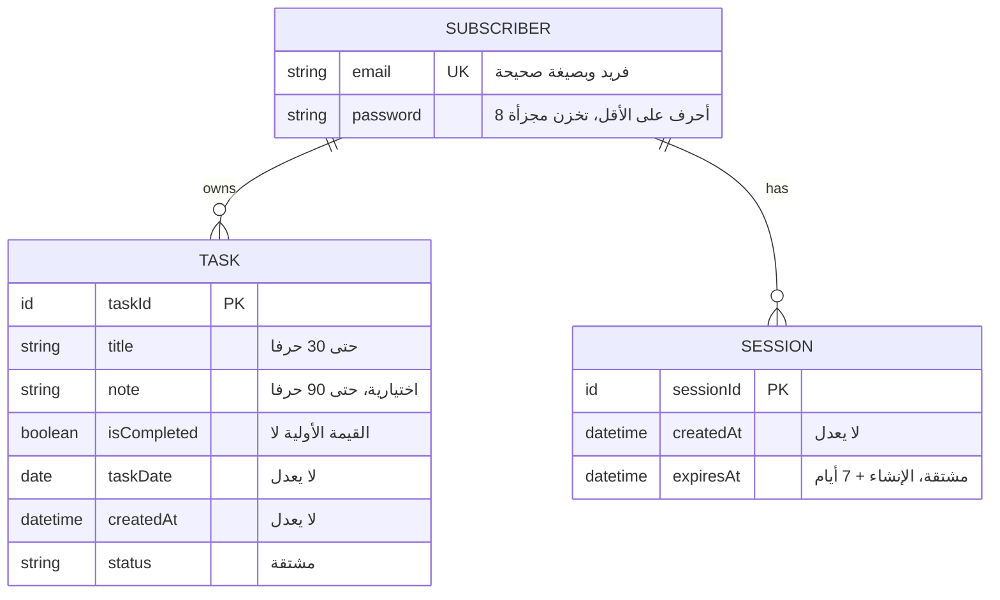
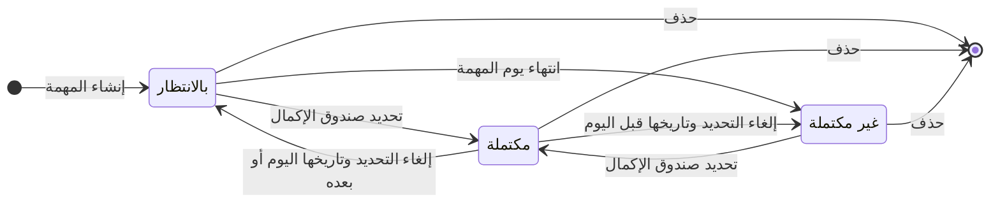
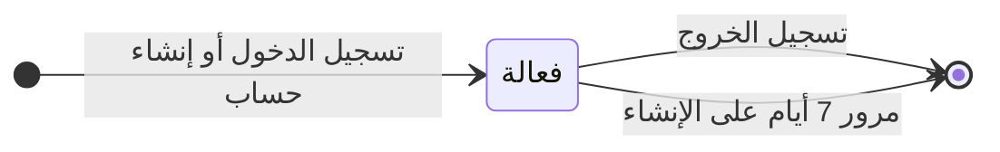

# التحليل

## 1. نموذج المجال

### 1.1 الكيانات

- **المشترك:** شخص أنشأ حساباً في النظام، ويدخل به لإدارة مهامه الخاصة.
- **المهمة:** بند يسجله المشترك ضمن يوم معين، ويحدد إنجازه.
- **الجلسة:** فترة دخول فعالة لمشترك على جهاز معين، تبدأ بتسجيل الدخول وتنتهي بتسجيل الخروج أو بمرور 7 أيام.

### 1.2 قاموس البيانات

#### كيان المشترك

| الخاصية | المعنى | النوع | إلزامية؟ | قيود |
| :--- | :--- | :--- | :--- | :--- |
| البريد الإلكتروني | يميز المشترك عن غيره من المشتركين | نص | نعم | صيغة بريد إلكتروني صحيح وفريد |
| كلمة المرور | تؤكد حساب المشترك وتؤمنه | نص | نعم | لا تقل عن 8 أحرف، مجزأة |

#### كيان المهمة

| الخاصية | المعنى | النوع | إلزامية؟ | قيود |
| :--- | :--- | :--- | :--- | :--- |
| معرف المهمة | المعرف الخاص بالمهمة ليعرفها عن بقية المهمات | معرف | نعم | لا يمكن تعديله، يولد تلقائياً، فريد وصعب تخمينه |
| العنوان | يحدد اسم للمهمة | نص | نعم | لا يتجاوز 30 حرفاً، لا يكون فارغاً أو يحوي مسافات فقط |
| الملاحظة | تحدد تفاصيل عن المهمة | نص | لا | لا تتجاوز 90 حرفاً |
| هل هي مكتملة؟ | لتحديد هل تم إنجاز المهمة أم لا | نعم / لا | نعم | قيمتها الأولية هي "لا" |
| التاريخ | اليوم الذي تنتمي إليه المهمة وتظهر في قائمته | تاريخ | نعم | لا يمكن تعديله، تؤخذ قيمته من قائمة اليوم |
| تاريخ الإنشاء | تاريخ ووقت إنشاء المهمة لترتيب المهام ضمن قائمة اليوم | تاريخ ووقت | نعم | لا يمكن تعديله، يولد تلقائياً |
| /الحالة | تميز حالة المهمة من صندوق الإكمال | مكتملة / غير مكتملة / بالانتظار | — | تُشتق تلقائياً من خاصية "هل هي مكتملة؟" والتاريخ |

#### كيان الجلسة

| الخاصية | المعنى | النوع | إلزامية؟ | قيود |
| :--- | :--- | :--- | :--- | :--- |
| معرف الجلسة | المعرف الخاص بالجلسة ليعرفها عن بقية الجلسات | معرف | نعم | لا يمكن تعديله، يولد تلقائياً، فريد وصعب تخمينه |
| تاريخ الإنشاء | التاريخ والوقت الذي يدل على لحظة إنشاء الجلسة | تاريخ ووقت | نعم | لا يمكن تعديله، يولد تلقائياً |
| /تاريخ الانتهاء | التاريخ والوقت الذي يدل على لحظة انتهاء الجلسة | تاريخ ووقت | — | لا يمكن تعديله، يُشتق تلقائياً من تاريخ الإنشاء |

> الخاصية التي يسبق اسمها `/` هي **خاصية مشتقة**: تُحسب ولا تُخزَّن.

### 1.3 العلاقات

| العلاقة | من جهة الأول | من جهة الثاني |
| :--- | :--- | :--- |
| **المشترك** ← **المهمة** | المشترك يملك **صفر مهمة أو أكثر** | كل مهمة تنتمي إلى **مشترك واحد بالضبط** |
| **المشترك** ← **الجلسة** | المشترك له **صفر جلسة أو أكثر** (جلسة لكل تسجيل دخول لم ينتهِ، أي لكل جهاز) | كل جلسة تنتمي إلى **مشترك واحد بالضبط** |

لا توجد علاقة مباشرة بين المهمة والجلسة.

### 1.4 مخطط الكيانات

أسماء الكيانات في الرسم بالإنجليزية لسلامة العرض: SUBSCRIBER = المشترك، TASK = المهمة، SESSION = الجلسة.

## 2. نموذج حالات الاستخدام

### 2.1 الفاعلون

- **الزائر:** شخص غير مسجل الدخول (قد يكون جديداً، أو صاحب حساب لم يدخل بعد).
- **المشترك:** شخص مسجل الدخول بحسابه.

### 2.2 حالات الاستخدام

| الرقم | الاسم | الفاعل | القصة المقابلة |
| :--- | :--- | :--- | :--- |
| UC-01 | إنشاء حساب | الزائر | إنشاء حساب |
| UC-02 | تسجيل الدخول | الزائر | تسجيل الدخول |
| UC-03 | تسجيل الخروج | المشترك | تسجيل الخروج |
| UC-04 | عرض مهام يوم | المشترك | عرض مهام اليوم |
| UC-05 | إضافة مهمة | المشترك | إضافة مهمة |
| UC-06 | تعديل مهمة | المشترك | تعديل مهمة |
| UC-07 | تغيير حالة الإكمال | المشترك | تغيير حالة الإكمال |
| UC-08 | حذف مهمة | المشترك | حذف مهمة |
| UC-09 | إنشاء جلسة | النظام (داخلي) | جزء من إنشاء الحساب وتسجيل الدخول |
| UC-10 | التحقق من الجلسة | النظام (داخلي) | جزء من كل ما يتطلب تسجيل الدخول |

### 2.3 مخطط حالات الاستخدام

المخطط مرسوم بـ Mermaid على هيئة مخطط تدفق، وهو تقريب لمخطط UML (الخطوط المتقطعة تعني «تتضمن»).

```mermaid
flowchart LR
    V["الزائر"]
    S["المشترك"]

    subgraph SYS["نظام قائمة المهام"]
        UC01(["UC-01 إنشاء حساب"])
        UC02(["UC-02 تسجيل الدخول"])
        UC03(["UC-03 تسجيل الخروج"])
        UC04(["UC-04 عرض مهام يوم"])
        UC05(["UC-05 إضافة مهمة"])
        UC06(["UC-06 تعديل مهمة"])
        UC07(["UC-07 تغيير حالة الإكمال"])
        UC08(["UC-08 حذف مهمة"])
        UC09(["UC-09 إنشاء جلسة"])
        UC10(["UC-10 التحقق من الجلسة"])
    end

    V --- UC01
    V --- UC02
    S --- UC03
    S --- UC04
    S --- UC05
    S --- UC06
    S --- UC07
    S --- UC08

    UC01 -. تتضمن .-> UC09
    UC02 -. تتضمن .-> UC09
    UC03 -. تتضمن .-> UC10
    UC04 -. تتضمن .-> UC10
    UC05 -. تتضمن .-> UC10
    UC06 -. تتضمن .-> UC10
    UC07 -. تتضمن .-> UC10
    UC08 -. تتضمن .-> UC10
```

### 2.4 وصف حالات الاستخدام

#### UC-01 إنشاء حساب
- **الفاعل:** الزائر.
- **التدفق الأساسي:**
  1. يدخل الزائر بريده الإلكتروني وكلمة المرور.
  2. يتحقق النظام من صحة صيغة البريد، ومن أنه غير مسجل مسبقاً، ومن أن كلمة المرور لا تقل عن 8 أحرف.
  3. ينشئ النظام حساباً للمشترك، ويخزّن كلمة المرور مجزأة.
  4. ينشئ النظام جلسة (UC-09).
  5. ينقل النظام المشترك إلى صفحة المهام.
- **التدفقات البديلة:**
  - 2أ. البريد بصيغة خاطئة أو مسجل مسبقاً أو كلمة المرور قصيرة: تظهر رسالة خطأ توضح السبب، ولا يُنشأ حساب.

#### UC-02 تسجيل الدخول
- **الفاعل:** الزائر (صاحب حساب).
- **التدفق الأساسي:**
  1. يدخل الزائر بريده الإلكتروني وكلمة المرور.
  2. يتحقق النظام من تعبئة الحقلين، ثم من تطابقهما مع حساب مسجل.
  3. ينشئ النظام جلسة (UC-09).
  4. ينقل النظام المشترك إلى صفحة المهام، وتُفتح قائمة اليوم الحالي.
- **التدفقات البديلة:**
  - 2أ. أحد الحقلين فارغ: لا يُرسل النموذج، وتظهر رسالة تطلب تعبئته.
  - 2ب. عدم التطابق: لا تُنشأ جلسة، وتظهر رسالة عامة واحدة ("البريد أو كلمة المرور غير صحيحة") دون تحديد أيهما الخطأ.

#### UC-03 تسجيل الخروج
- **الفاعل:** المشترك. **الشرط المسبق:** مسجل الدخول (UC-10).
- **التدفق الأساسي:**
  1. يضغط المشترك زر تسجيل الخروج.
  2. تظهر نافذة تأكيد بخيارين: "نعم" و"لا".
  3. يختار "نعم".
  4. يحذف النظام الجلسة الحالية فقط، ولا تتأثر جلسات الأجهزة الأخرى.
  5. ينقل النظام المشترك إلى صفحة تسجيل الدخول.
- **التدفقات البديلة:**
  - 3أ. يختار "لا": تُغلق النافذة ويبقى المشترك داخل حسابه.
  - بعد الخروج: أي طلب إلى صفحة المهام أو بياناتها يُرفض ويُوجَّه إلى صفحة تسجيل الدخول دون عرض أي بيانات.

#### UC-04 عرض مهام يوم
- **الفاعل:** المشترك. **الشرط المسبق:** مسجل الدخول (UC-10).
- **التدفق الأساسي:**
  1. بعد الدخول تُفتح قائمة اليوم الحالي.
  2. يعرض النظام مهام المشترك وحده لليوم المحدد، مرتبة من الأحدث إنشاءً.
  3. تعرض كل مهمة: العنوان، والملاحظة (إن وجدت)، وصندوق الإكمال، وحالتها (بالانتظار، أو مكتملة، أو غير مكتملة).
  4. يتنقل المشترك إلى قائمة يوم آخر، ضمن 30 يوماً قبل اليوم الحالي و30 يوماً بعده.
  5. يعود إلى قائمة اليوم الحالي بزر "اليوم الحالي".
- **التدفقات البديلة:**
  - 2أ. لا توجد مهام في اليوم: تُعرض قائمة يوم فارغة.
  - 4أ. بلوغ حد التنقل: لا يمكن التنقل أبعد من ذلك.

#### UC-05 إضافة مهمة
- **الفاعل:** المشترك. **الشرط المسبق:** مسجل الدخول (UC-10)، وفي قائمة يوم تاريخه اليوم الحالي أو بعده.
- **التدفق الأساسي:**
  1. يضغط المشترك زر الإضافة في قائمة اليوم.
  2. يعرض النظام نموذج الإضافة.
  3. يدخل المشترك العنوان، وملاحظة اختيارية.
  4. يضغط "حفظ".
  5. يتحقق النظام من القيود (الحد الأقصى، والعنوان غير الفارغ).
  6. ينشئ النظام المهمة بتاريخ القائمة، وقيمة "هل هي مكتملة؟" = لا (حالتها بالانتظار)، ويسجل تاريخ الإنشاء.
  7. بعد تأكد الحفظ، يُغلق النموذج وتظهر المهمة في قائمة اليوم.
- **التدفقات البديلة:**
  - 5أ. العنوان فارغ أو مسافات فقط: لا تُحفظ المهمة.
  - 3أ / 4أ. يغلق المشترك النموذج دون حفظ: تُهمل البيانات.
  - 7أ. فشل الحفظ: تظهر رسالة خطأ ويبقى النموذج بما أُدخل فيه (القاعدة العامة).
  - قوائم الأيام السابقة: لا يوجد زر إضافة، ويرفض الخادم أي طلب إنشاء بتاريخ سابق.

#### UC-06 تعديل مهمة
- **الفاعل:** المشترك. **الشرط المسبق:** مسجل الدخول (UC-10)، والمهمة في يوم هو اليوم الحالي أو بعده.
- **التدفق الأساسي:**
  1. يضغط المشترك على عنوان مهمة.
  2. يعرض النظام نموذج التعديل بقيمها الحالية.
  3. يعدّل العنوان و/أو الملاحظة، ثم يضغط "حفظ".
  4. يتحقق النظام من القيود نفسها المطبقة عند الإضافة.
  5. يحدّث النظام العنوان والملاحظة فقط، ولا يتغير تاريخ المهمة ولا تاريخ إنشائها.
  6. بعد تأكد الحفظ، يُغلق النموذج.
- **التدفقات البديلة:**
  - 3أ. يغلق المشترك النموذج دون حفظ: تُهمل التعديلات.
  - 4أ. قيم غير صالحة: لا يُحفظ التعديل.
  - مهام الأيام السابقة: لا يُفتح نموذج التعديل لها.

#### UC-07 تغيير حالة الإكمال
- **الفاعل:** المشترك. **الشرط المسبق:** مسجل الدخول (UC-10).
- **التدفق الأساسي:**
  1. يضغط المشترك على صندوق الإكمال لمهمة في أي يوم.
  2. يقلب النظام قيمة "هل هي مكتملة؟" (نعم تصبح لا، ولا تصبح نعم).
  3. تتحدث الحالة المعروضة بحسب قاعدة الاشتقاق:
     - مهمة اليوم الحالي أو بعده: تنتقل بين "بالانتظار" و"مكتملة".
     - مهمة يوم سابق: تنتقل بين "غير مكتملة" و"مكتملة".

#### UC-08 حذف مهمة
- **الفاعل:** المشترك. **الشرط المسبق:** مسجل الدخول (UC-10).
- **التدفق الأساسي:**
  1. يضغط المشترك زر "حذف" لمهمة (في أي يوم وبأي حالة).
  2. تظهر نافذة تأكيد بخيارين: "متأكد" و"تراجع".
  3. يختار "متأكد".
  4. يحذف النظام المهمة نهائياً دون إمكانية استرجاعها، وتُغلق النافذة.
- **التدفقات البديلة:**
  - 3أ. يختار "تراجع": تُغلق النافذة وتبقى المهمة.

#### UC-09 إنشاء جلسة (داخلي)
- **المشغّل:** UC-01 وUC-02.
- **التدفق الأساسي:**
  1. ينشئ النظام جلسة جديدة للمشترك بمعرّف فريد صعب التخمين وتاريخ إنشاء.
  2. تكون صلاحيتها 7 أيام ثابتة من لحظة إنشائها (لا تتجدد بالاستخدام).
  3. يسلّم النظام المتصفح ما يثبت به الجلسة في طلباته اللاحقة.
- **ملاحظة:** كل تسجيل دخول ينشئ جلسة جديدة مستقلة.

#### UC-10 التحقق من الجلسة (داخلي)
- **المشغّل:** كل طلب يتطلب تسجيل الدخول (UC-03 إلى UC-08).
- **التدفق الأساسي:**
  1. يتحقق النظام من وجود الجلسة المرتبطة بالطلب ومن أنها لم تنتهِ.
  2. يتابع النظام تنفيذ الطلب لمشتركها.
- **التدفقات البديلة:**
  - 1أ. الجلسة غير موجودة أو منتهية: يرفض النظام الطلب ويوجّه إلى صفحة تسجيل الدخول.

## 3. قواعد العمل

القواعد العامة (1 و2 و5) في وثيقة المتطلبات تسري على كل ما يلي: التحقق في الواجهة والخادم معاً، ومعالجة فشل العمليات، وحفظ كل تغيير.

| الرقم | القاعدة | المصدر | حالات الاستخدام |
| :--- | :--- | :--- | :--- |
| BR-01 | البريد الإلكتروني فريد بين المشتركين | إنشاء حساب | UC-01 |
| BR-02 | يجب أن يكون البريد الإلكتروني بصيغة صحيحة | إنشاء حساب | UC-01 |
| BR-03 | كلمة المرور لا تقل عن 8 أحرف، وتُخزَّن مجزأة ولا يمكن استرجاعها | إنشاء حساب، المتطلبات غير الوظيفية | UC-01 |
| BR-04 | عند عدم تطابق بيانات الدخول تظهر رسالة عامة واحدة دون تحديد الحقل الخطأ | تسجيل الدخول | UC-02 |
| BR-05 | مدة الجلسة 7 أيام ثابتة من لحظة إنشائها، ولا تتجدد بالاستخدام | تسجيل الدخول | UC-09 |
| BR-06 | تُحذف الجلسة عند تسجيل الخروج أو انقضاء مدتها، ولا يُحتفظ بسجل للجلسات المنتهية | تسجيل الخروج | UC-03، UC-10 |
| BR-07 | كل تسجيل دخول ينشئ جلسة مستقلة، والخروج من جهاز لا يؤثر على جلسات الأجهزة الأخرى | تسجيل الخروج | UC-02، UC-03 |
| BR-08 | يُرفض أي طلب بجلسة غير موجودة أو منتهية ويُوجَّه إلى صفحة تسجيل الدخول | تسجيل الخروج | UC-10 |
| BR-09 | العنوان إلزامي، حتى 30 حرفاً شاملة المسافات، ولا يُقبل فارغاً أو مسافات فقط | إضافة مهمة | UC-05، UC-06 |
| BR-10 | الملاحظة اختيارية، حتى 90 حرفاً شاملة المسافات، والمسافات فقط لا تُسجَّل ملاحظة | إضافة مهمة | UC-05، UC-06 |
| BR-11 | تاريخ المهمة هو يوم القائمة التي أُضيفت فيها، ولا يمكن تعديله | إضافة مهمة، تعديل مهمة | UC-05، UC-06 |
| BR-12 | لا يمكن إنشاء مهمة بتاريخ قبل اليوم الحالي (لا زر في الواجهة، والخادم يرفض الطلب) | إضافة مهمة | UC-05 |
| BR-13 | المهمة الجديدة قيمة "هل هي مكتملة؟" فيها "لا"، أي حالتها "بالانتظار" | إضافة مهمة | UC-05 |
| BR-14 | تكرار عناوين المهام مسموح | إضافة مهمة | UC-05 |
| BR-15 | تُرتَّب مهام اليوم من الأحدث إنشاءً (بتاريخ الإنشاء) | عرض مهام اليوم | UC-04 |
| BR-16 | تعديل المهمة لا يغيّر تاريخ إنشائها | تعديل مهمة | UC-06 |
| BR-17 | حالة المهمة مشتقة: **مكتملة** إن كان صندوقها محدداً؛ **بالانتظار** إن كان غير محدد وتاريخها اليوم الحالي أو بعده؛ **غير مكتملة** إن كان غير محدد وتاريخها قبل اليوم الحالي | عرض مهام اليوم | UC-04، UC-07 |
| BR-18 | تعديل العنوان والملاحظة مسموح لمهام اليوم الحالي وما بعده فقط | تعديل مهمة | UC-06 |
| BR-19 | تغيير حالة الإكمال والحذف مسموحان في كل الأيام | تغيير حالة الإكمال، حذف مهمة | UC-07، UC-08 |
| BR-20 | حذف المهمة نهائي ولا يمكن استرجاعه، ويتطلب تأكيداً | حذف مهمة | UC-08 |
| BR-21 | يُسمح بالتنقل حتى 30 يوماً قبل اليوم الحالي و30 يوماً بعده | عرض مهام اليوم | UC-04 |
| BR-22 | يرى كل مشترك مهامه فقط | قاعدة عامة 4 | UC-04 إلى UC-08 |
| BR-23 | "اليوم الحالي" يُحسب بتوقيت متصفح المشترك | قاعدة عامة 3 | UC-04، UC-05 |

## 4. نموذج الحالات

### 4.1 حالات المهمة

المخطط يوضح الحالات المعروضة للمهمة (وهي مشتقة، وفق BR-17). الانتقال من "بالانتظار" إلى "غير مكتملة" لا يغيّر شيئاً مخزناً: يحدث بمرور الزمن فقط. والمهمة المكتملة تبقى مكتملة بعد انتهاء يومها.

### 4.2 دورة حياة الجلسة

لا توجد حالة "منتهية" مخزنة: بعد الانتهاء تُحذف الجلسة (BR-06)، والجلسة التي تجاوزت مدتها تُعامل كغير صالحة حتى لو بقي سجلها لحظة قبل حذفه.

## 5. التتبع والأسئلة المفتوحة

### 5.1 جدول التتبع

| القصة | حالات الاستخدام | الكيانات | قواعد العمل |
| :--- | :--- | :--- | :--- |
| إنشاء حساب | UC-01، UC-09 | المشترك، الجلسة | BR-01، BR-02، BR-03، BR-05، BR-07 |
| تسجيل الدخول | UC-02، UC-09 | المشترك، الجلسة | BR-04، BR-05، BR-07 |
| تسجيل الخروج | UC-03، UC-10 | الجلسة | BR-06، BR-07، BR-08 |
| إضافة مهمة | UC-05، UC-10 | المهمة | BR-09 إلى BR-15 |
| عرض مهام اليوم | UC-04، UC-10 | المهمة | BR-15، BR-17، BR-21، BR-22، BR-23 |
| تغيير حالة الإكمال | UC-07، UC-10 | المهمة | BR-17، BR-19 |
| تعديل مهمة | UC-06، UC-10 | المهمة | BR-09، BR-10، BR-11، BR-16، BR-18 |
| حذف مهمة | UC-08، UC-10 | المهمة | BR-19، BR-20 |

### 5.2 ما كشفه التحليل

لم يتطلب التحليل تعديل نص أي قصة، لكنه كشف أمرين أضيفا إلى النموذج:
- **ترتيب المهام** يحتاج خاصية "تاريخ الإنشاء" في المهمة، ولم تكن مذكورة صراحة في المتطلبات.
- **الخروج من جهاز واحد وإنهاء الجلسة فعلياً** يتطلبان أن تكون **الجلسة كياناً** يحتفظ به النظام.

### 5.3 قرارات مؤجلة

| الموضوع | يُحسم في |
| :--- | :--- |
| كيف يحمل المتصفح ما يثبت به الجلسة (كوكي أو غيره)، وصفاته الأمنية | التصميم |
| آلية حذف الجلسات المنتهية فعلياً (مهمة دورية أو غيرها) | التصميم |
| كيف يعرف الخادم "اليوم الحالي" للمشترك (إرسال التاريخ أو المنطقة الزمنية من المتصفح) | التصميم |
| خوارزمية تجزئة كلمات المرور | التصميم |
| تخزين التاريخ والوقت، وتمييز مهمتين أُنشئتا في اللحظة نفسها | التصميم |
| استضافة الخادم على Vercel (دوال تعمل عند الطلب)، ومكان تخزين الجلسات | التصميم والنشر |
| جلب مهام يوم واحد في كل طلب | التصميم (واجهة الـ API) |
| هل تكشف رسالة "البريد مسجل مسبقاً" عند إنشاء الحساب معلومة لا ينبغي كشفها؟ | التصميم |
| مظهر الحالات الثلاث (لون، رمز)، وعدم الاعتماد على اللون وحده | التصميم (الواجهات) |
| الحالات الحدّية للجلسات (تسجيل الدخول من الجهاز نفسه مرتين، وتجاوز منتصف الليل والصفحة مفتوحة، وإضافة مهمة عند 11:59 ثم الحفظ بعد 12:00، وفتح التطبيق في تبويبين) | الاختبار |
| لصق نص أطول من الحد في حقل العنوان أو الملاحظة | الاختبار |