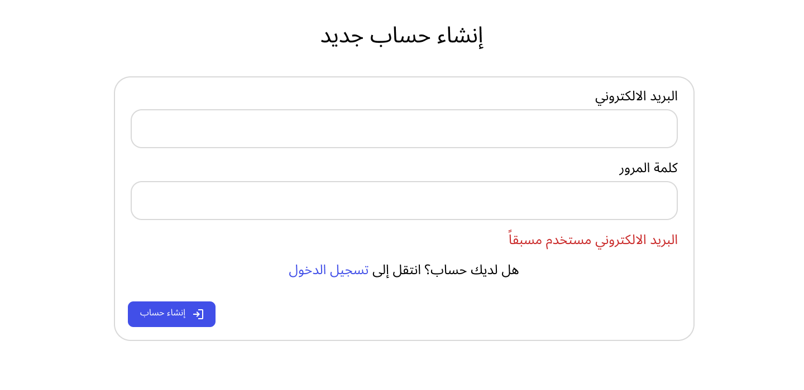
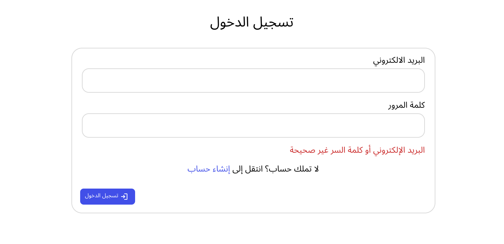
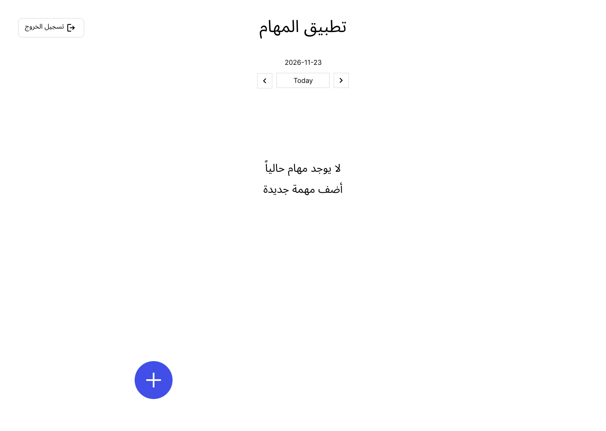
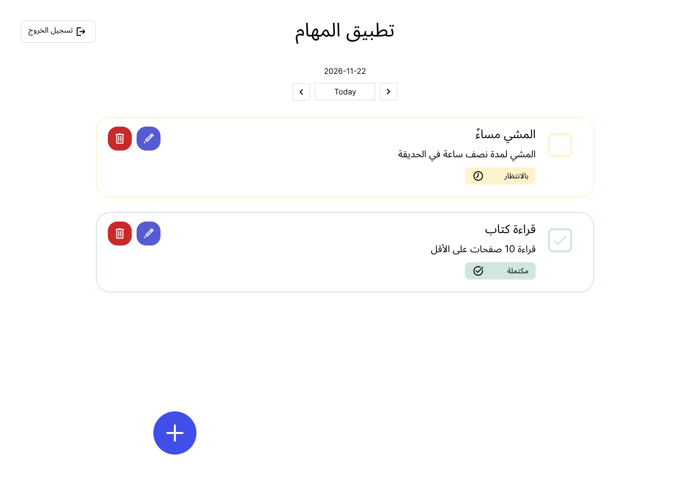
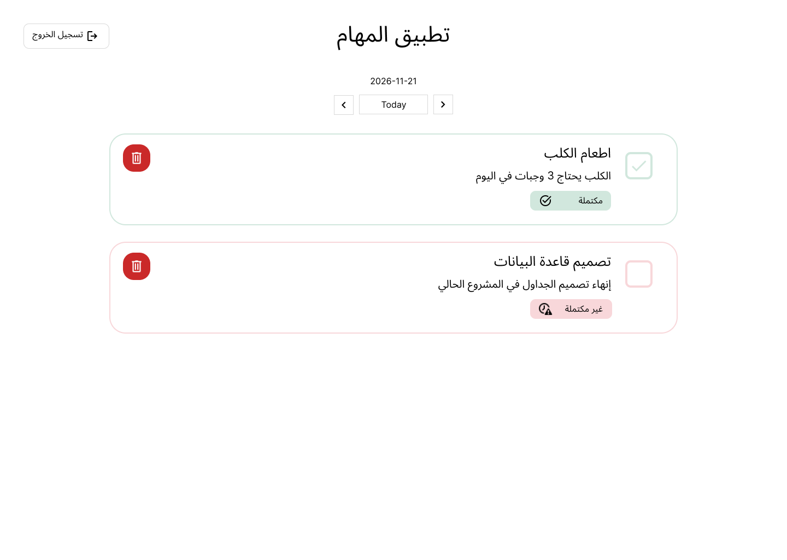
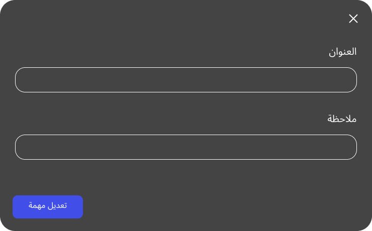

# التصميم

تحوّل هذه الوثيقة المتطلبات (`01-requirements.md`) والتحليل (`02-analysis.md`) إلى قرارات تقنية. تُشار فيها إلى القواعد بأرقام **BR** وإلى حالات الاستخدام بأرقام **UC** دون إعادة نصها.

## 1. المعمارية والنشر

### 1.1 القرارات التقنية

| الجانب | الاختيار | ملاحظة |
| :--- | :--- | :--- |
| الواجهة | React مع Vite، بلغة JavaScript | التوجيه بـ React Router |
| الخادم | Node.js وExpress | |
| قاعدة البيانات | MongoDB Atlas مع Mongoose | |
| المصادقة | جلسات في قاعدة البيانات عبر Cookie | تفرضها BR-06 وBR-07 وBR-08 (إنهاء فعلي ولكل جهاز) |
| تجزئة كلمات المرور | Argon2id (مكتبة `argon2`) | |
| المستودع | مستودع واحد: `frontend` و`backend` و`docs` | |
| الاستضافة | Vercel: مشروعان من المستودع نفسه، جذراهما `frontend` و`backend` | |
| الاتصال | مسار `/api` من نطاق الواجهة نفسه | يبقي الكوكي من الطرف الأول ويغني عن CORS |

### 1.2 توجيه `/api`

- **التطوير المحلي:** Vite Proxy يوجّه `/api` إلى الخادم المحلي.
- **الإنتاج:** `frontend/vercel.json` بقاعدتين، الترتيب مهم:

```json
{
  "rewrites": [
    { "source": "/api/:path*", "destination": "https://<backend-domain>/api/:path*" },
    { "source": "/(.*)", "destination": "/index.html" }
  ]
}
```

القاعدة الأولى تمرّر طلبات الـ API إلى مشروع الخادم، والثانية تعيد أي مسار آخر إلى `index.html` ليعمل تحديث الصفحة على `/login` و`/register`.

### 1.3 بيئة Serverless وقاعدة البيانات

- يعمل الخادم على Vercel Functions: لا حالة في ذاكرة الخادم بين الطلبات، والجلسات في MongoDB.
- يُحفظ اتصال Mongoose (أو وعده) في متغير على مستوى الملف لإعادة استخدامه بين الطلبات.
- Atlas: IP Access List بـ `0.0.0.0/0` (عناوين Vercel متغيرة)، مع مستخدم قاعدة بيانات بصلاحيات محدودة على قاعدة المشروع فقط وكلمة مرور قوية.
- متغيرات البيئة للخادم: `MONGODB_URI` و`NODE_ENV` و`PORT` (محلياً). تُحفظ في `.env` خارج المستودع، ويُرفق `.env.example` بلا قيم.
- HTTPS توفره Vercel. تُفعَّل `Secure` للكوكي في الإنتاج فقط.

## 2. قاعدة البيانات

معاني الحقول في قاموس البيانات (التحليل 1.2)؛ هنا الأنواع التقنية والفهارس فقط.

### 2.1 `members`

| الحقل | النوع | القيود | الفهرس |
| :--- | :--- | :--- | :--- |
| `_id` | ObjectId | تلقائي | افتراضي |
| `email` | String | إلزامي؛ يُطبَّع (6.2) | فريد |
| `password_hash` | String | إلزامي؛ ناتج Argon2id بصيغة PHC | — |

### 2.2 `tasks`

| الحقل | النوع | القيود | الفهرس |
| :--- | :--- | :--- | :--- |
| `_id` | ObjectId | تلقائي | افتراضي |
| `member_id` | ObjectId | إلزامي؛ مرجع إلى `members` | ضمن المركب |
| `title` | String | إلزامي؛ حتى 30 حرفاً | — |
| `note` | String | اختياري؛ حتى 90 حرفاً؛ لا يُخزَّن إن كان فارغاً | — |
| `date` | String | إلزامي؛ `YYYY-MM-DD` | ضمن المركب |
| `is_complete` | Boolean | الافتراضي `false` | — |
| `created_at` | Date | يضبطه الخادم (UTC) | ضمن المركب |

- **الفهرس المركب** (غير فريد): `{ member_id: 1, date: 1, created_at: -1 }`. يخدم استعلام UC-04، والترتيب `created_at` ثم `_id` تنازلياً (BR-15).
- **`date` نص** لأنه يوم تقويمي بلا ساعة ولا منطقة، فتُجرى مقارنات التواريخ نصياً.
- **`status` غير مخزَّن**؛ يحسبه الخادم عند الإرجاع (BR-17).

### 2.3 `sessions`

| الحقل | النوع | القيود | الفهرس |
| :--- | :--- | :--- | :--- |
| `_id` | ObjectId | تلقائي | افتراضي |
| `session_id` | String | إلزامي؛ 32 بايتاً عشوائياً (CSPRNG) بترميز base64url | فريد |
| `member_id` | ObjectId | إلزامي؛ مرجع إلى `members` | غير فريد |
| `created_at` | Date | يضبطه الخادم | — |
| `expires_at` | Date | `created_at` + 7 أيام (BR-05) | TTL: `expireAfterSeconds: 0` |

- `expires_at` **مخزَّنة** رغم أنها مشتقة في التحليل، لأن فهرس TTL يحتاج حقلاً فعلياً.
- حذف TTL غير لحظي، لذلك يتحقق الخادم من `expires_at` في كل طلب محمي (3.3).
- `_id` معرّف السجل، و`session_id` ما يحمله الكوكي؛ لا يُستبدل أحدهما بالآخر.

## 3. المصادقة والجلسات

### 3.1 كلمات المرور
تُجزَّأ بـ Argon2id. تولّد المكتبة الملح عشوائياً وتخزنه مع الإعدادات داخل النص (PHC). ويتم التحقق بدالة `verify` الخاصة بها لا بمقارنة نصية. وطول 8 أحرف يُفحص على النص الأصلي قبل التجزئة.

### 3.2 إنشاء الجلسة (UC-09)
عند إنشاء الحساب أو الدخول ينشئ الخادم سجل جلسة ويرسل `session_id` في Cookie. لا تُجدَّد الجلسة بالاستخدام.

| الخاصية | القيمة |
| :--- | :--- |
| Name | `session_id` |
| HttpOnly | `true` |
| Secure | `true` في الإنتاج فقط |
| SameSite | `Lax` |
| Path | `/` |
| Max-Age | `604800` (7 أيام) |

### 3.3 التحقق من الجلسة (UC-10)
`authMiddleware` على كل مسار محمي:
1. قراءة `session_id` من الكوكي.
2. البحث عن الجلسة في `sessions`.
3. التأكد أن `expires_at` أكبر من الوقت الحالي.
4. ربط `member_id` من الجلسة بالطلب (لا يُقبل أي معرّف مشترك من الواجهة).
5. عند أي فشل: `401` بالرمز `UNAUTHORIZED`.

### 3.4 تسجيل الخروج (UC-03)
حذف سجل الجلسة المطابق للكوكي فقط (BR-07) ومسح الكوكي، والرد `204`.

## 4. واجهة الـ API

### 4.1 اتفاقيات عامة
- كل المسارات تحت `/api`، وكل الطلبات والردود JSON.
- يُعرض `_id` باسم `id`. ولا يُرسل أبداً `member_id` أو `password_hash` أو `session_id`.
- **الترويسة `X-Timezone`** (اسم IANA مثل `Asia/Damascus`) مطلوبة في: `GET /api/tasks` و`POST /api/tasks` و`PATCH /api/tasks/:id` و`PATCH /api/tasks/:id/completion`. يحسب الخادم منها "اليوم" بصيغة `YYYY-MM-DD` لتطبيق BR-12 وBR-18 وBR-21 وحساب `status` (BR-23). وإن كانت غير صالحة فالرد `400` بالرمز `INVALID_TIMEZONE`.

### 4.2 شكل البيانات

```json
// member
{ "id": "674f...", "email": "user@example.com" }

// task  (note غير موجودة إن لم توجد ملاحظة)
{
  "id": "674f...",
  "title": "قراءة كتاب",
  "note": "نصف ساعة",
  "date": "2026-11-23",
  "is_complete": false,
  "created_at": "2026-11-23T09:30:00.000Z",
  "status": "pending"
}
```

قيم `status`: `pending` أو `incomplete` أو `completed` (BR-17).

### 4.3 المسارات

| UC | المسار | المدخلات | النجاح | الأخطاء |
| :--- | :--- | :--- | :--- | :--- |
| UC-01 | `POST /api/auth/register` | `{ email, password }` | `201` `{ member }` + كوكي | `REQUIRED` `INVALID_EMAIL` `PASSWORD_TOO_SHORT` `EMAIL_ALREADY_EXISTS` |
| UC-02 | `POST /api/auth/login` | `{ email, password }` | `200` `{ member }` + كوكي | `REQUIRED` `INVALID_CREDENTIALS` |
| — | `GET /api/auth/me` | — | `200` `{ member }` | `UNAUTHORIZED` |
| UC-03 | `POST /api/auth/logout` | — | `204` + مسح الكوكي | `UNAUTHORIZED` |
| UC-04 | `GET /api/tasks?date=YYYY-MM-DD` | `date` | `200` `{ tasks: [...] }` | `INVALID_DATE` `DATE_OUT_OF_RANGE` `INVALID_TIMEZONE` `UNAUTHORIZED` |
| UC-05 | `POST /api/tasks` | `{ title, note?, date }` | `201` `{ task }` | `REQUIRED` `TITLE_TOO_LONG` `NOTE_TOO_LONG` `INVALID_DATE` `PAST_DATE_NOT_ALLOWED` `DATE_OUT_OF_RANGE` `INVALID_TIMEZONE` `UNAUTHORIZED` |
| UC-06 | `PATCH /api/tasks/:id` | `{ title?, note? }` | `200` `{ task }` | `INVALID_ID` `REQUIRED` `TITLE_TOO_LONG` `NOTE_TOO_LONG` `PAST_TASK_NOT_EDITABLE` `INVALID_TIMEZONE` `UNAUTHORIZED` `TASK_NOT_FOUND` |
| UC-07 | `PATCH /api/tasks/:id/completion` | `{ is_complete }` | `200` `{ task }` | `INVALID_ID` `INVALID_VALUE` `INVALID_TIMEZONE` `UNAUTHORIZED` `TASK_NOT_FOUND` |
| UC-08 | `DELETE /api/tasks/:id` | — | `204` | `INVALID_ID` `UNAUTHORIZED` `TASK_NOT_FOUND` |

ملاحظات:
- **المهام المعادة** من `GET /api/tasks` مرتبة بـ `created_at` تنازلياً ثم `_id` تنازلياً، وهي مهام المشترك في ذلك اليوم فقط، أو مصفوفة فارغة.
- **الحقول الداخلية** (`member_id` و`is_complete` الأولية و`created_at` و`status`) لا تُقبل في طلب الإنشاء، ويضبطها الخادم (BR-13).
- **تعديل `PATCH /api/tasks/:id`:** الحقل الغائب لا يتغير، و`note` الفارغة (بعد `trim`) تمسح الملاحظة، و`title` الفارغ يُرفض. ولا يقبل الطلب `date` ولا `is_complete` (BR-11 وBR-16).
- **404 `TASK_NOT_FOUND`** للمهمة غير الموجودة وللتي لا تخص المشترك (BR-22)، فلا يُكشف وجودها.
- **تسجيل الدخول** يتحقق من وجود الحقلين فقط، ولا يفحص صيغة البريد، فيعيد `INVALID_CREDENTIALS` لكل فشل آخر (BR-04).

### 4.4 رموز الأخطاء

شكل الرد: `{ "error": { "code": "...", "field": "..." } }`، و`field` اختياري. ولا ترسل الواجهة نصوصاً من الخادم، بل تترجم `code` إلى رسالة عربية (5.2).

| الرمز | HTTP | الحقل | المعنى |
| :--- | :--- | :--- | :--- |
| `REQUIRED` | 400 | `email` `password` `title` `date` | حقل إلزامي مفقود أو فارغ |
| `INVALID_EMAIL` | 400 | `email` | صيغة البريد غير صحيحة |
| `PASSWORD_TOO_SHORT` | 400 | `password` | أقل من 8 أحرف |
| `TITLE_TOO_LONG` | 400 | `title` | أكثر من 30 حرفاً |
| `NOTE_TOO_LONG` | 400 | `note` | أكثر من 90 حرفاً |
| `INVALID_DATE` | 400 | `date` | صيغة التاريخ أو قيمته غير صالحة |
| `PAST_DATE_NOT_ALLOWED` | 400 | `date` | إنشاء مهمة بتاريخ سابق (BR-12) |
| `DATE_OUT_OF_RANGE` | 400 | `date` | خارج ±30 يوماً (BR-21) |
| `PAST_TASK_NOT_EDITABLE` | 400 | — | تعديل مهمة يومها سابق (BR-18) |
| `INVALID_TIMEZONE` | 400 | — | `X-Timezone` مفقودة أو غير صالحة |
| `INVALID_ID` | 400 | — | معرّف المهمة ليس ObjectId صالحاً |
| `INVALID_VALUE` | 400 | `is_complete` | القيمة ليست Boolean |
| `INVALID_CREDENTIALS` | 401 | — | بيانات الدخول غير صحيحة |
| `UNAUTHORIZED` | 401 | — | لا توجد جلسة صالحة |
| `TASK_NOT_FOUND` | 404 | — | المهمة غير موجودة أو ليست للمشترك |
| `EMAIL_ALREADY_EXISTS` | 409 | `email` | البريد مسجل مسبقاً |
| `INTERNAL_ERROR` | 500 | — | خطأ غير متوقع، دون أي تفاصيل داخلية |

## 5. الواجهة

### 5.1 الشاشات (Figma)

تصاميم الواجهة مرتبة ضمن الصور التالية، ومخزنة في  `docs/images/`.

| الشاشة | الصورة | UC |
| :--- | :--- | :--- |
| إنشاء حساب |  | UC-01 |
| تسجيل الدخول |  | UC-02 |
| المهام (يوم فارغ) |  | UC-04 |
| المهام (فيها مهام) |  | UC-04، UC-07 |
| المهام (يوم سابق) |  | UC-04، UC-07، UC-08 |
| نموذج الإضافة |  | UC-05 |
| نموذج التعديل |  | UC-06 |


التصميم الحالي لسطح المكتب. **تصميم الهاتف والتابلت** يُنجز بعد تنفيذ واجهة سطح المكتب، ويبقى متطلب التجاوب في المتطلبات غير الوظيفية قائماً.

### 5.2 السلوك

| الموضوع | التصميم |
| :--- | :--- |
| **المسارات** | `/login` و`/register` و`/` (صفحة المهام). ولا يتغير الرابط بالتنقل بين الأيام: اليوم المعروض حالة داخل الصفحة |
| **حالة الدخول** | عند التشغيل تستدعي الواجهة `GET /api/auth/me` (الكوكي `HttpOnly` لا تقرؤه JavaScript). الزائر يُحوَّل إلى `/login`، والمشترك يُحوَّل من `/login` و`/register` إلى `/` |
| **خطأ 401** | أي `UNAUTHORIZED` من مسار محمي يمسح حالة الدخول ويحوّل إلى `/login` (BR-08) |
| **التاريخ** | تحسب الواجهة "اليوم" من منطقة المتصفح، وطبقة الطلبات المشتركة (`services/api.js`) تضيف `X-Timezone` تلقائياً |
| **التنقل بين الأيام** | سهم اليوم السابق على اليمين والتالي على اليسار (RTL)، ويُعطَّلان عند حدّ ±30 يوماً. زر "اليوم الحالي" بالعربية |
| **أزرار المهمة** | الإضافة لليوم الحالي وما بعده (BR-12)، والتعديل لهما فقط (BR-18)، والحذف وصندوق الإكمال في كل الأيام (BR-19). والخادم هو الذي يفرض ذلك |
| **عرض المهمة** | العنوان، والملاحظة إن وجدت، وصندوق الإكمال (`is_complete`)، وشارة `status` القادمة من الخادم، وزرا التعديل والحذف |
| **النماذج** | تُغلق بزر إغلاق (X) دون حفظ، وتُغلق بعد نجاح الطلب فقط، وتُبقي القيم عند الفشل. وأخطاء الحقول تظهر بجانب الحقل حسب `field` |
| **رسائل الأخطاء** | ملف `constants/errorMessages.js` يربط كل `code` بنص عربي. والأخطاء بلا `field` وأخطاء الشبكة تظهر برسالة عامة |
| **التأكيد** | `confirm()` الأصلي للمتصفح عند الخروج والحذف، بنص عربي (BR-20) |

### 5.3 مظهر الحالات

| `status` | النص | الخلفية | لون النص | الأيقونة |
| :--- | :--- | :--- | :--- | :--- |
| `pending` | بالانتظار | `#FFF3CD` | `#664D03` | ساعة |
| `incomplete` | غير مكتملة | `#F8D7DA` | `#842029` | تنبيه |
| `completed` | مكتملة | `#D1E7DD` | `#0F5132` | علامة صح |

## 6. التحقق ومعالجة الأخطاء

يطبّق الخادم كل القواعد (القاعدة العامة 1)، وتكرر الواجهة ما يلزم لسرعة الاستجابة.

### 6.1 الترتيب في الخادم
1. المصادقة (3.3)، ثم `X-Timezone`، ثم صحة `id` والجسم، ثم الملكية (404)، ثم قواعد التاريخ (BR-12 وBR-18 وBR-21)، ثم الكتابة.
2. لا تُنفَّذ كتابة جزئية عند أي فشل (القاعدة العامة 2).

### 6.2 التطبيع قبل التحقق

| الحقل | المعالجة |
| :--- | :--- |
| `email` | `trim` ثم `toLowerCase`، عند التسجيل والدخول معاً |
| `password` | بلا `trim` |
| `title` | `trim`، ثم يُفحص أنه غير فارغ وأن طوله ≤ 30 |
| `note` | `trim`؛ الفارغة تُعامل كغير موجودة (وفي التعديل تمسح الملاحظة السابقة)؛ طولها ≤ 90 |
| `date` | بصيغة `YYYY-MM-DD` وتاريخ تقويمي صحيح |

### 6.3 الأخطاء
- أخطاء الخادم غير المتوقعة تُسجَّل في الخادم فقط، ويعيد الرد `INTERNAL_ERROR` بلا تفاصيل أو Stack Trace.
- لا تعرض الواجهة نجاحاً قبل استلام ردّ نجاح من الخادم.

## 7. هيكل المشروع

```text
todo-app/
├── frontend/
│   ├── src/
│   │   ├── pages/            Register, Login, Tasks
│   │   ├── components/       TaskItem, TaskForm, TaskList, DateNavigation, StatusBadge
│   │   ├── services/         api.js (الطلبات المشتركة)، auth.js، tasks.js
│   │   ├── constants/        errorMessages.js
│   │   ├── styles/
│   │   ├── App.jsx           التوجيه وحراسة المسارات
│   │   └── main.jsx
│   ├── vercel.json
│   └── package.json
├── backend/
│   ├── src/
│   │   ├── config/           db.js
│   │   ├── models/           Member.js, Task.js, Session.js
│   │   ├── routes/           authRoutes.js, taskRoutes.js
│   │   ├── controllers/      authController.js, taskController.js
│   │   ├── middleware/       authMiddleware.js, errorHandler.js
│   │   ├── utils/            validators.js, dates.js, session.js
│   │   └── app.js            إعداد Express (يُصدَّر التطبيق)
│   ├── server.js             تشغيل محلي
│   ├── .env.example
│   └── package.json
├── docs/
│   ├── images/
│   ├── 01-requirements.md
│   ├── 02-analysis.md
│   └── 03-design.md
├── .gitignore
└── README.md
```

لا يوجد `package.json` في الجذر: لكل مجلد اعتمادياته.

## 8. التتبع

### 8.1 حالات الاستخدام

| UC | المسار | الواجهة | الخادم |
| :--- | :--- | :--- | :--- |
| UC-01 | `POST /api/auth/register` | Register | authController، utils/session |
| UC-02 | `POST /api/auth/login` | Login | authController، utils/session |
| UC-03 | `POST /api/auth/logout` | زر الخروج، `confirm()` | authController |
| UC-04 | `GET /api/tasks`، `GET /api/auth/me` | Tasks، DateNavigation، TaskList، StatusBadge | taskController، utils/dates |
| UC-05 | `POST /api/tasks` | TaskForm (إضافة) | taskController |
| UC-06 | `PATCH /api/tasks/:id` | TaskForm (تعديل) | taskController |
| UC-07 | `PATCH /api/tasks/:id/completion` | صندوق الإكمال في TaskItem | taskController |
| UC-08 | `DELETE /api/tasks/:id` | زر الحذف، `confirm()` | taskController |
| UC-09 | داخل register وlogin | — | utils/session |
| UC-10 | كل مسار محمي | — | authMiddleware |

### 8.2 قواعد العمل ومكان فرضها

| BR | يُفرض في |
| :--- | :--- |
| 01 | فهرس `email` الفريد، والمتحكم (`409`) |
| 02، 03 | `validators.js` (وفي الواجهة)، وتجزئة Argon2id |
| 04 | `INVALID_CREDENTIALS` لكل فشل دخول |
| 05، 06 | `expires_at` وMax-Age وفهرس TTL وحذف الخروج |
| 07 | سجل جلسة لكل دخول، والحذف بالكوكي الحالي |
| 08 | `authMiddleware`، وتحويل الواجهة عند `401` |
| 09، 10 | `validators.js` (وفي الواجهة)، وحدود Mongoose |
| 11، 16 | `PATCH` لا يقبل `date`، و`created_at` يضبط عند الإنشاء فقط |
| 12، 18، 21 | الخادم بـ`X-Timezone` وأرقام BR؛ والواجهة تخفي الأزرار وتعطل الأسهم |
| 13 | الخادم يضبط `is_complete = false` ولا يقبلها في الطلب |
| 14 | لا فهرس فريد على `title` |
| 15 | الفهرس المركب وترتيب الاستعلام |
| 17 | الخادم يحسب `status` ولا يخزنها |
| 19 | لا فحص تاريخ في `completion` و`DELETE` |
| 20 | `DELETE` حذف فعلي، و`confirm()` |
| 22 | `member_id` من الجلسة في كل استعلام، و`404` لغير المالك |
| 23 | الترويسة `X-Timezone` |

## 9. فحوصات تقنية مبكرة

قبل بناء التطبيق، تُجرَّب على Vercel أربعة أمور في مشروعين صغيرين:
1. أن الكوكي المرسَل من الخادم عبر قاعدة `/api` يظهر تحت نطاق الواجهة نفسه.
2. أن مكتبة `argon2` تعمل في بيئة Vercel.
3. أن الاتصال بـ Atlas يعمل من دوال Vercel.
4. الملف الذي تنشره Vercel نقطةَ دخولٍ لتطبيق Express، وتحديد ما يُصدَّر منه، حسب وثائقها الحالية.